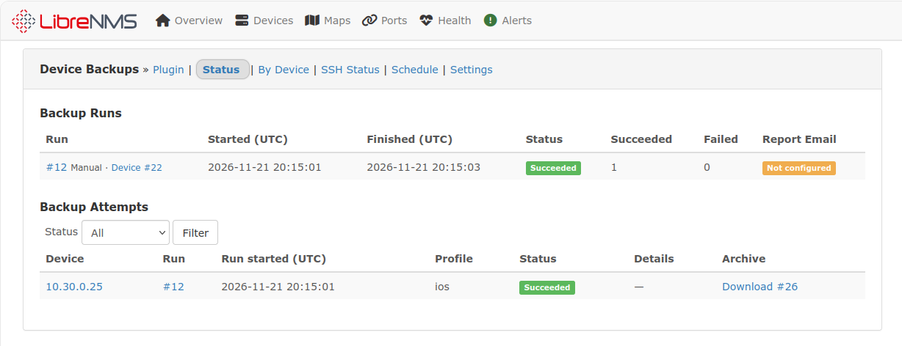
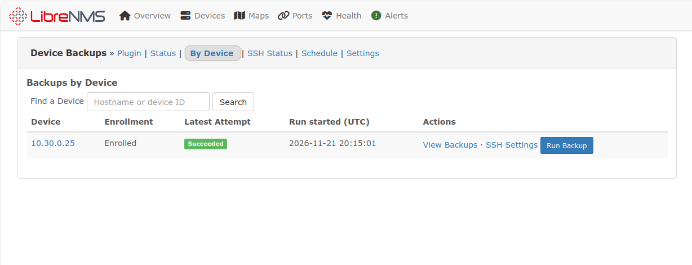
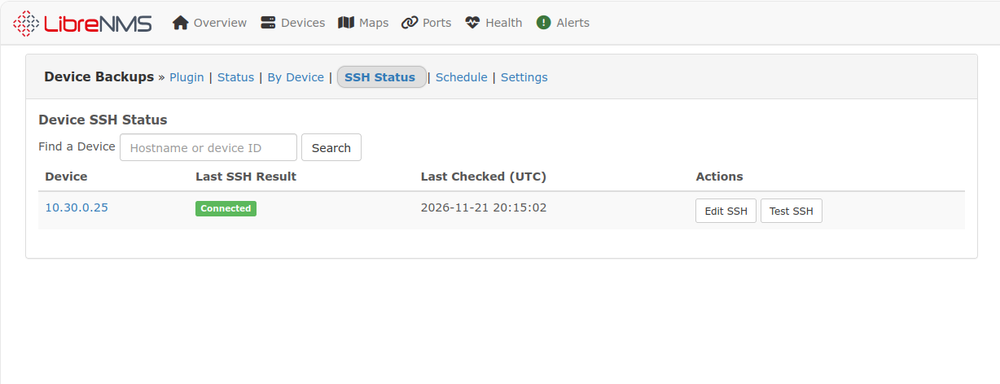
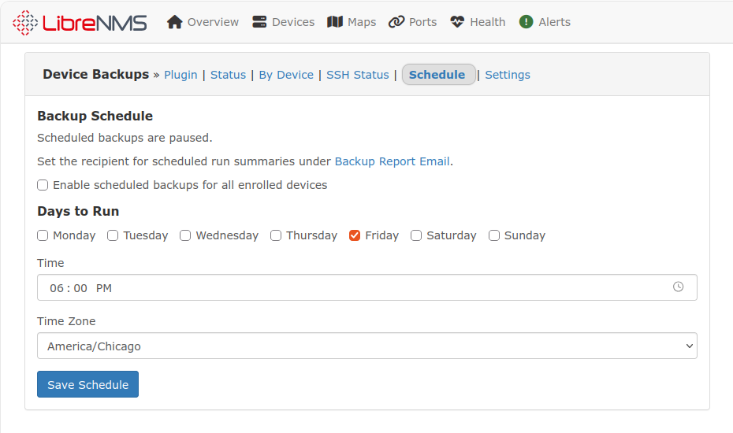

# Device Backups

Device Backups is a LibreNMS plugin for backing up network device configurations and selected server files over SSH. It uses the LibreNMS inventory and stores verified AES-256 ZIP archives in a separate backup database. LibreNMS admins can enroll devices, test SSH, queue backups, set a schedule, and download archives from the web interface.

## License & Support

This project is open-source under the [MIT License](LICENSE). If this plugin helps simplify your LibreNMS device backups, consider supporting future development via [GitHub Sponsors](https://github.com).

[](https://buymeacoffee.com/daryl.peterson)


## Install and configure

Use PHP 8.4 or later with ZIP and AES-256 support, Phar, and zlib. Run the following commands from the LibreNMS installation directory as the LibreNMS service user.

For a local checkout, register it as a Composer path repository and install the plugin. Replace the checkout path with your own.

```bash
cd /opt/librenms
./scripts/composer_wrapper.php config --global repositories.librenms-device-backups \
  '{"type":"path","url":"/absolute/path/to/librenms-device-backups","options":{"symlink":true}}'
./lnms plugin:add daryl-peterson/librenms-device-backups dev-main
./lnms plugin:enable device-backups
```

During installation, Laravel's package discovery clears a route cache that is missing the **Device Backups** status route. If you pull route changes into a symlinked checkout, run `./lnms route:clear` and reload LibreNMS.

1. Open **Device Backups → Settings** and enter the credentials for the separate MySQL or MariaDB database. Click **Test and Save Settings**. The plugin saves the credentials after it verifies the connection.
2. Click **Run Migrations** to apply the pending Device Backups migrations to the saved database. The database user needs permission to create and alter the plugin tables and indexes. This completes database setup and enables backup functions.
3. Set `DEVICE_BACKUPS_ARCHIVE_PASSWORD` in LibreNMS's environment. Keep it with your recovery credentials. If you change it later, older ZIPs still need their original password.
4. Optionally enter a recipient under **Device Backups → Settings → Backup Report Email** and click **Test and Save Settings**. LibreNMS sends one email after each scheduled backup run. It identifies the run, shows the completed and failed counts, and lists each failed device with its error. Manual backup results are available in **Status**.

Click **Send Test Email** to check delivery to the address currently in the field before saving it.

After changing the database connection, click **Test and Save Settings**, then **Run Migrations**. If an update adds a migration, run it from Settings before resuming backups.

## Enroll a device and check SSH

Open **Device Backups → SSH Status**, find the device, and click **Configure SSH** or **Edit SSH**. The device overview also links to **SSH Settings**.

1. Choose a backup profile and enter the username, password, and port for the device's existing SSH account.
2. Enter the verified SHA256 host key fingerprint. **Read Host Key** shows the fingerprint the device presents. Compare it with the device console or another trusted source before saving it.
3. For switch profiles that require a CLI hostname, enter the name shown in the device prompt. Supply an enable password if the SSH account needs it to read the configuration. EdgeSwitch detects its CLI prompt automatically.
4. Click **Save SSH Settings**, then **Test Saved SSH Settings**. The SSH Status page shows the last result and check time for each device. Manual tests and backup runs both update it.

The plugin encrypts the saved SSH credentials. When editing an enrolled device, leave the password field blank to keep the saved password. **Remove Enrollment** stops future backups and keeps the device's stored archives.

## Run and monitor backups

- **Run one device.** Click **Run Backup** on the device overview, in its backup history, or on **By Device**. The LibreNMS scheduler checks queued requests each minute, including when recurring backups are paused.
- **Run on a schedule.** Open **Device Backups → Schedule**, select the days, time, and time zone, enable scheduled backups, and click **Save Schedule**. The page shows the next run. The schedule applies to all enrolled, enabled devices.
- **Check results.** **Status** shows backup runs, success and failure counts, and report email status. Filter backup attempts by run or result. **By Device** shows each device's latest attempt and links to its history.

An existing `DEVICE_BACKUPS_SCHEDULED=true` setting supplies the Friday 6 p.m. America/Chicago schedule until you save a schedule in the web interface.

### CLI commands

```bash
./lnms device-backups:configure DEVICE_ID
./lnms device-backups:run DEVICE_ID --check
./lnms device-backups:run DEVICE_ID
./lnms device-backups:process-requests --check
./lnms schedule:list
```

Use `--profile=PROFILE` with the configure command to select a server profile or override the detected device OS. Use `--disable` to remove enrollment. Omit the device ID from the run command to back up all enrolled, enabled devices.

If the scheduler reports that `device-backups:process-requests` exited with code 1, check **Device Backups → Status** for a failed backup attempt. Run `./lnms device-backups:process-requests --check` to verify the queue schema and database read access without starting a backup.

## Supported profiles

| Platform                                        | Profiles                                                    | Backup contents                                                                      |
| ----------------------------------------------- | ----------------------------------------------------------- | ------------------------------------------------------------------------------------ |
| Dell, Cisco IOS/IOS XE, NX-OS, ASA, Nokia TiMOS | `dell`, `ios`, `nxos`, `asa`, `timos`                       | Running configuration as `running-config.txt`                                        |
| Ubiquiti EdgeSwitch                             | `edgeswitch`                                                | Running configuration as `running-config.txt`                                        |
| Ubiquiti EdgeRouter                             | `edgeos`                                                    | Saved startup configuration from `/config/config.boot`                               |
| Ubiquiti airOS and classic airFiber             | `airos`, `airfiber`                                         | Configuration from `/tmp/system.cfg`                                                 |
| ISC DHCP, BIND DNS, and Kea                     | `dhcp`, `dns`, `dhcp-dns`, `dhcp-dns-old`, `dns-old`, `kea` | Service configuration and applicable lease files in `configuration-and-state.tar.gz` |
| Restricted DHCP and Kea helpers                 | `dhcp-helper`, `kea-helper`                                 | Validated archive produced by the server helper                                      |

Direct server profiles require an SSH account that can read the selected files. The helper profiles call the existing `/usr/local/sbin/netmonitor-dhcp-backup` or `/usr/local/sbin/netmonitor-kea-backup` with noninteractive sudo.

Classic airFiber support covers the `AF…#` SSH prompt. UniFi controller backups, airFiber 60, LTU, Telnet, and the deployment-specific SMx export are outside the current profiles. [EdgeRouter configuration files](https://help.uisp.com/hc/en-us/articles/22591188157079-EdgeRouter-Archiving-and-Managing-the-Configuration-Files) · [EdgeSwitch CLI reference](https://dl.ui.com/guides/edgemax/EdgeSwitch_CLI_Command_Reference_UG.pdf) · [airOS and airFiber collectors](https://github.com/ytti/oxidized/tree/master/lib/oxidized/model) · [UniFi backups](https://help.ui.com/hc/en-us/articles/360008976393-Backups-and-Migration-in-UniFi)

## Download and restore

Use **Download Latest Backup** on the device overview or in its backup history to get the newest successful archive. Choose an older backup ID in the history to download that archive.

Web downloads use `<short-system-name>.YYYYMMDDHHSS.zip`, for example `carlton-1g-sw01.202611210142.zip`. The timestamp is the backup run's start time in the LibreNMS application time zone. When the system name is unavailable, the plugin uses the short form of the recorded hostname.

You can also export by backup ID from the CLI:

```bash
./lnms device-backups:export BACKUP_ID /path/to/new-backup.zip
```

The plugin verifies the stored checksum before delivering the ZIP. Open it with the archive password and follow the device or service's restore procedure.

## Tests

Run from the plugin checkout with PHP 8.4 or later, PDO SQLite, Phar, zlib, ZIP with AES-256 support, and the PHPUnit extensions. [PHPUnit requirements](https://docs.phpunit.de/en/12.5/installation.html)

```bash
composer install
composer test
```

To run only one suite:

```bash
composer test -- --testsuite unit
composer test -- --testsuite database
```

Composer installs test dependencies in `.test-vendor`. The suite uses mock SSH sessions, temporary files, and in-memory SQLite. It runs independently of LibreNMS.

## Screen Shots







